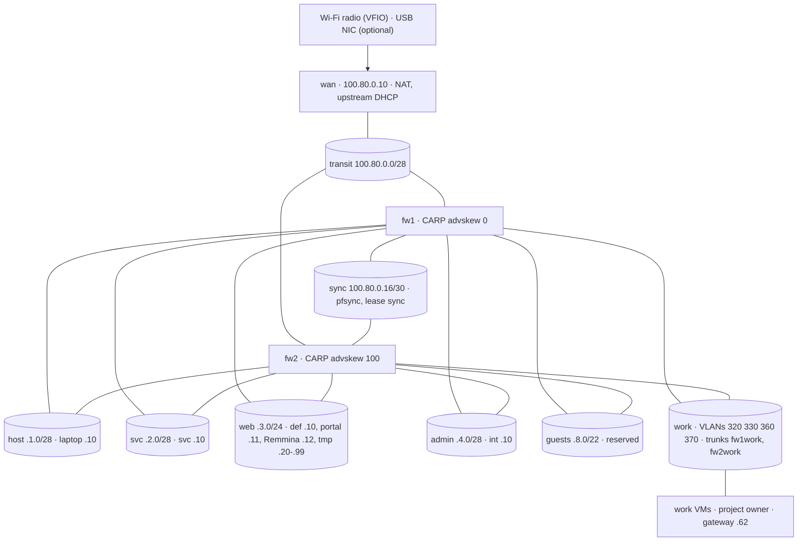
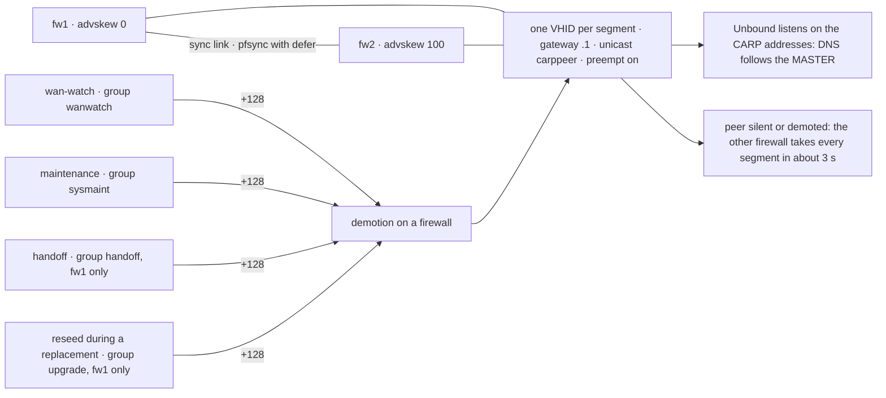
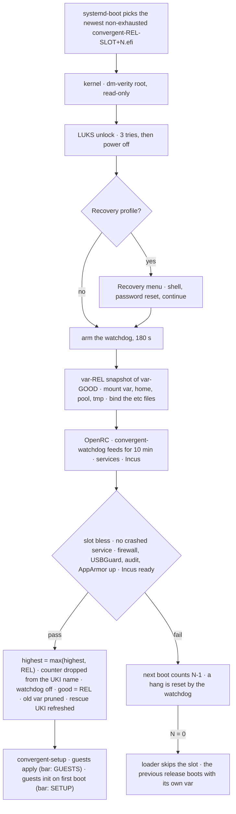
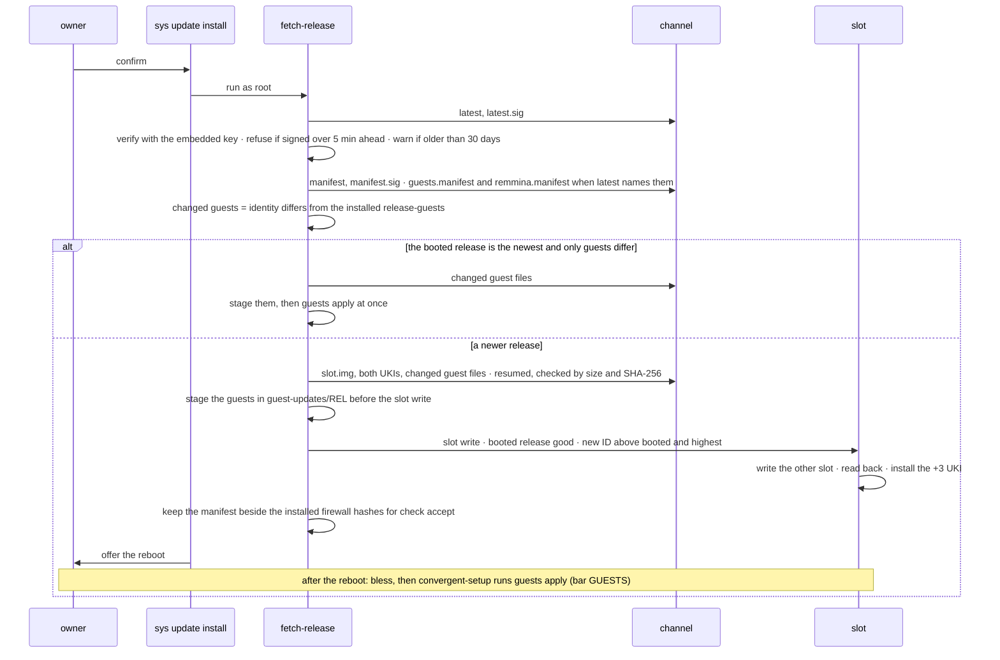
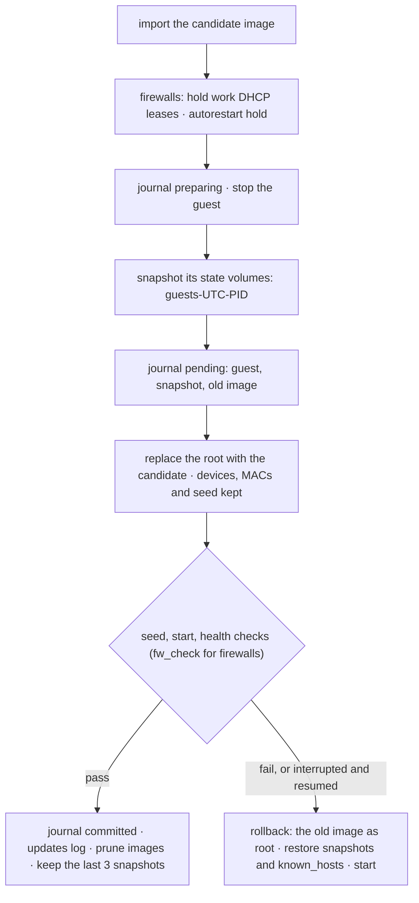
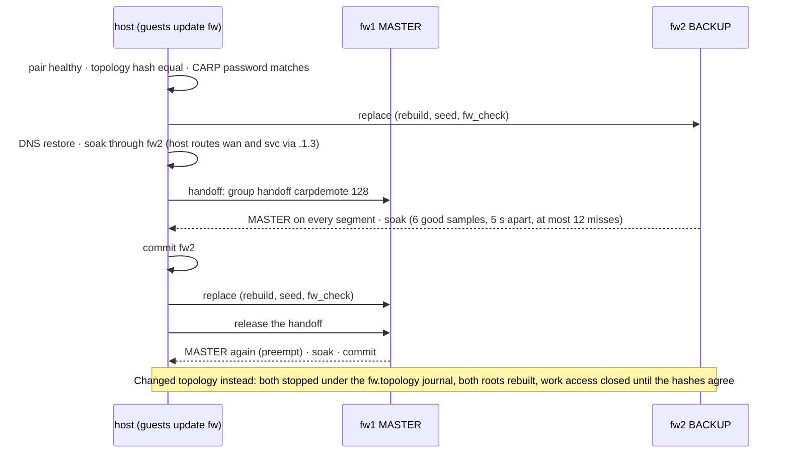
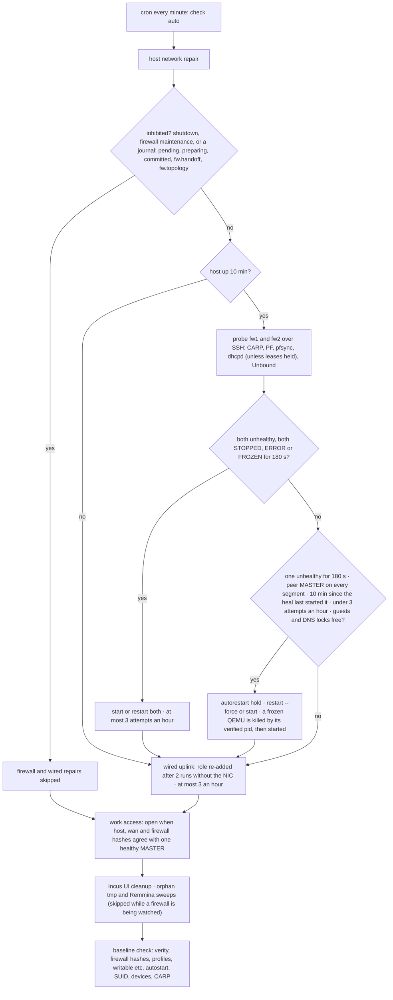

# Convergent architecture

What Convergent is made of, where its boundaries lie and why. Commands: [USAGE](USAGE.md); repairs:
[RECOVERY](RECOVERY.md); build and test status: [BUILD](BUILD.md#status). Unfinished work is marked
"Planned:" or "Not built:".

## 1. Principles

- **Verified root.** dm-verity checks every block of the OS image on read. Not built: Secure Boot
  signing, so firmware does not authenticate the UKI or its root hash.
- **Built elsewhere.** The laptop receives whole images; it carries no compiler or package manager.
- **Compartments.** The radio, the firewalls, monitoring, browsers and work VMs are separate guests;
  PF decides what passes between them.
- **Fail closed.** Both firewalls down stops every routed flow; only same-VLAN work traffic stays
  local.
- **A/B replacement.** The previous release stays bootable with its own `/var`.
- **Declared configuration.** Validated build inputs and repository files define the image.

## 2. Overview

Network topology: every segment is a layer-2 Incus bridge; `fw1` and `fw2` sit on all of them.

The `host` bridge is the one with a host address (100.80.1.10). `wan` owns the radio and does NAT;
everything else reaches it through the firewalls. `fw1` and `fw2` share one CARP gateway per
segment, so a failover moves every gateway at once. Single-address system NICs are bound to their
addresses by Incus filtering. Work VLANs rely on MAC filtering and the host's bridge rules instead,
because Incus cannot combine VLANs with IP filtering. Addresses: section 4.1; flows: section 4.2.

## 3. Components

### 3.1 Host

| Area | Implementation |
|---|---|
| Base | Gentoo hardened profile, OpenRC, glibc; systemd-utils supplies the boot tools |
| Kernel | Gentoo kernel plus `build/kernel.config`: confidentiality lockdown, enforced module signatures with an ephemeral build key, built-in verity, EROFS, storage and KVM |
| Not built in | kexec, suspend, hibernation and host Wi-Fi; unused protocols and buses are left out (`build/kernel.config`) |
| Image trimming | Unused modules and filesystems removed or blocked; setuid only for sudo, su, passwd, unix_chkpwd and the D-Bus helper; no file capabilities |
| Command line | `init_on_alloc`, `slab_nomerge`, page and stack randomization, no vsyscall or debugfs; `fbcon=nodefer` applies the console font at boot |
| Kernel interfaces | Restricted ptrace, perf, BPF, pointers and dmesg; protected links and FIFOs; no TIOCSTI, line-discipline autoload, redirects, source routing or core dumps; strict reverse-path filtering |
| DMA | `intel_iommu=on iommu.strict=1 efi=disable_early_pci_dma`; NVIDIA functions on vfio-pci with runtime power management; the radio alone in its IOMMU group, no ACS override |
| Confinement | AppArmor host profiles (section 5.3) plus Incus-generated guest profiles |
| Audit | Immutable rules watch identity files, USB policy, guest keys, the checker baseline, DNS state and the sudo log, and record root commands and module changes; forwarded to `svc` |
| Accounts | Root locked; the owner in wheel, seat, audio, video and dialout; su limited to wheel; sudo with a PTY, its own log and a 5 min ticket; yescrypt; 5 failures lock login for 15 min |
| Session | seatd, greetd with tuigreet on tty1, Sway, foot, bemenu, mako, swaylock and swayidle; session PipeWire and WirePlumber; SOF firmware and ALSA UCM for SoundWire |
| Virtualization | Incus: QEMU/KVM for VMs, LXC for containers; UI assets pinned for Incus 7.0.1 |
| Devices | USBGuard with state-bound rules changed over IPC; a disk-image install allows all-HID or all-storage devices and hubs, a physical install the devices present at install, until [enrolment](USAGE.md#first-boot); camera modules load only after a saved choice (section 9) |
| Power | No suspend; CPU preference and cap applied at boot and on power-source events; optional charge and thermal controls leave the fans to firmware |
| Time | chrony with NTS sources (three by default, two must agree); starts without network and serves NTP to the firewalls |
| Network | nftables input restrictions and no host forwarding (section 4.4) |

Planned: boot verification of Thunderbolt protection; ACPI-event masking.

`INCUS_SKIP_INSTANCE_TYPES=true` keeps Incus from downloading instance-type definitions. Storage
and boot: section 5. Logs and crashes: section 8 and
[RECOVERY 13](RECOVERY.md#13-a-kernel-panic-or-crashrecorded-alert).

### 3.2 wan (VM)

Alpine LTS kernel on an ext4 root. `wan` owns the VFIO radio, runs iwd and the upstream DHCP
client, and performs NAT. It has no Incus agent or guest API; the host reaches it only over SSH on
`transit`, with OpenSSH's default key exchange.

#### Uplinks

- Wi-Fi: a random MAC per network, the regulatory country, protected management frames where
  offered; no DHCP hostname, mDNS or LLMNR, so the upstream learns little.
- Wired: a passed-through USB Ethernet adapter (`devices wired attach`, Incus USB `required=false`,
  Realtek firmware included). It sends no hostname but keeps the adapter's MAC and udhcpc's vendor
  class.
- Overlapping upstream leases are refused and raise `UpstreamOverlap`. Each uplink keeps its own
  refusal, so two overlapping uplinks do not flap.
- Wired DHCP state is cleared after removal, an addressless replug, or an identity or carrier
  change. Incus does not re-attach a replugged NIC by serial; the checker re-adds the role
  ([Self-heal](#self-heal)).

#### Credentials

Credentials arrive over SSH stdin and are stored in `wan`; replies are sanitized. Replacement also
stages root-only copies on encrypted host storage, which can remain until recovery or cleanup
completes. After association the host checks Wi-Fi IPv4 six times, 5 s apart. Saved networks
survive a replacement unless they fail the check in section 7.2.

#### Limits

- NAT conntrack holds 65,536 flows; a full table drops new NAT flows. `WanConntrackHigh` fires above
  80 % for 5 min.
- Output upstream allows DHCP; output to transit allows replies and syslog. Input allows management,
  metrics and firewall probes. Private forwarding is limited by section 4.2.
- PTP over KVM disciplines the guest's chrony without a network listener; it follows the host's
  clock even when it steps.
- HPET off, free-page reporting on. Memory: section 11.

Controls: [USAGE, Wi-Fi](USAGE.md#wi-fi), [USAGE, Devices](USAGE.md#devices),
[USAGE, Captive portals](USAGE.md#captive-portals). Diagnostics:
[RECOVERY 8](RECOVERY.md#8-where-the-logs-are).

### 3.3 fw1, fw2 (VMs)

Two OpenBSD VMs, each with one interface per system segment, a work VLAN trunk (`vio7`) and the
sync link (`vio1`). Separate kernels keep a firewall failure away from the host kernel.

#### CARP and pfsync

- One VHID per segment; `fw1` advskew 0, `fw2` advskew 100; `net.inet.carp.preempt=1`.
- Unicast `carppeer`, so the pair does not depend on bridge multicast.
- pfsync replicates state on the sync link (with `defer`), so established connections survive a
  failover.
- `wan-watch`, maintenance, handoff and a reseeded `fw1` demote a firewall by 128; the triggers are
  in section 4.3.

#### Services

- PF: routing and filtering, per-source and rule-wide state caps (web, guests, work) in a
  100,000-state table, an MSS clamp toward `wan`, and release ruleset hashes.
- Unbound listens on the CARP addresses, so DNS follows failover. rc gives it 120 s to start;
  `fw-seed` sets that at seeding, not in the image.
- DHCP on the work VLANs only. `dhcpd` syncs leases to the peer over the sync link; a replacement
  checkpoints and reseeds them.
- Management: host-only SSH, NTP from the host, an exporter and TLS syslog to `svc`, default route
  via `wan`. ntpd only slews, so the host steps each firewall's clock once per boot with rdate,
  and again after the self-heal restarts or a rebuild replaces that firewall.

#### Locks

- Firewall-side work holds a kernel flock on `/var/run/convergent-maintenance.lock`; the PID inside
  is informational. A reboot clears `/var/run`.
- Maintenance demotes group `sysmaint` by 128 and leaves a journal on the host until
  `sys firewall undo`; the `wanwatch` and `handoff` counters are untouched.
- A replacement records its progress and seeding durably and skips completed work on retry.
- Incus reads and configuration changes in a guest operation are bounded to 120 s; a timeout names
  the frozen guest ([RECOVERY 4](RECOVERY.md#a-frozen-guest-qemu)).

The checker's firewall repairs: [Self-heal](#self-heal). Procedures:
[USAGE, Firewall maintenance](USAGE.md#firewall-maintenance).

### 3.4 svc (container)

An unprivileged Alpine container on its own segment.

| Service | Role |
|---|---|
| VictoriaMetrics | Scrapes host, firewall and `wan` metrics; bounded cache, retention and queries |
| VictoriaLogs | TLS syslog; bounded cache, retention and queries |
| vmalert | Alert evaluation and the bar's alert API |
| vmauth | Query proxy |
| Grafana | Authenticated dashboards on svc's address; anonymous access off; runs only while a plain `int` browser is open |

While `svc` is replaced the host buffers logs and the bar reports unknown alert counts. DNS does not
depend on `svc`. Retention and collection: section 8; memory: section 11.

### 3.5 Browsers

One Alpine Chromium image supplies the unprivileged `def`, `tmp` and `int` containers. Roles,
persistence and commands: [USAGE, Browsers](USAGE.md#browsers). Each container gets:

- a restricted Sway security-context socket: no capture, injection, other Wayland sockets, Sway IPC
  or X11;
- its own playback-only pipewire-pulse socket; no recording, D-Bus or desktop portals;
- a private download directory and the Intel render node; portal mode renders in software;
- policies that disable DoH (gateway DNS only), telemetry and background networking.

Window titles name the role. A stopped `tmp` container left by a crash is deleted only under its
slot lock. The portal browser (`tmp --portal`) runs at `a_portal` with 512 MiB, `wan`'s DNS, no
render device, HTTP-enabled captive-page policies, and no capture, extensions or search.
Addresses: section 4.1. Planned: external links opening in `tmp`.

#### Incus management

Only `int` reaches the Incus UI and API. PF admits `int`; host nftables drops every other TCP 8443
packet before the loopback and established accepts. Metrics use a separate identity on port 8444.

`tools/incus-ui` creates a 90-day client certificate through sudo. Only the AES-256 encrypted
PKCS#12 and the public certificate persist, in root-only TLS state. Each session prompts in a host
terminal, verifies the fingerprint and imports the key as UID 1000 into fresh tmpfs NSS state; both
persistent NSS locations are masked, even for a plain `int`. Import precedes trust; closing `int`
stops the session and removes its trust and data. Boot and `check auto` clean orphans; an
interrupted rotation restores a complete credential directory. An Incus session also gets its own
Chromium profile on a tmpfs that ends with `int`, and a policy limited to the Incus origin;
Grafana-only launches get neither, and no key. Each Incus session first rebuilds `int`'s root
from the installed image, so nothing a Grafana session changed there sees the key. Commands:
[USAGE, Incus management](USAGE.md#incus-management).

#### Remmina

A separate unprivileged Alpine container on `web` with restricted Wayland, playback-only audio and
the browser session and update locks. No GPU, host D-Bus, SSH agent or host-directory mount. A
software-rendered Cage isolates its clipboard. Only numeric work destinations are reachable
(section 4.2).

The shifted `remmina-state` volume mounts at `/home/remmina`. A private session bus unlocks GNOME
Keyring; a cancelled, locked or plaintext keyring aborts the launch. The patched client clears
credentials when Secret Service fails rather than saving them locally. A compromised unlocked client
can read its credentials.

The shifted `share` volume mounts at `/share`; explicit VM attachments allow cross-domain file
transfer. An update restores only `remmina-state`, never `share`. The checker stops orphan sessions.
Sizes: section 11; commands and sharing: [USAGE, Remote desktops](USAGE.md#remote-desktops).

### 3.6 Work VMs

`guests init` creates project `owner` with NIC-only `work-<domain>-a|b` profiles on the shared
managed networks. The owner supplies disks and resources in Incus. Work profiles turn the Incus
guest API off and deny Btrfs subvolume ioctls inside work containers; `work-` profile names are
reserved. Planned: creating work VMs through `sys`. Configuration:
[USAGE, Work VMs](USAGE.md#work-vms).

## 4. Network

### 4.1 Addressing

Internal space is 100.80.0.0/16 (RFC 6598 shared space); `wan` refuses an upstream lease that
overlaps it. Changing the space means coordinated host, `wan`, firewall and tool configuration.

| Segment | Prefix | CARP gateway and DNS | fw1 | fw2 | Members |
|---|---|---|---|---|---|
| transit | 100.80.0.0/28 | .1 (no DNS) | .2 | .3 | wan .10 |
| sync | 100.80.0.16/30 | none | .17 | .18 | none |
| host | 100.80.1.0/28 | .1 | .2 | .3 | host .10 |
| svc | 100.80.2.0/28 | .1 | .2 | .3 | svc .10 |
| web | 100.80.3.0/24 | .1 | .2 | .3 | def .10, portal .11, Remmina .12, tmp .20–.99 |
| admin | 100.80.4.0/28 | .1 | .2 | .3 | int .10 |
| guests | 100.80.8.0/22 | .1 | .2 | .3 | reserved |
| dom-dev-a, dom-dev-b | 100.80.32.0/26, 100.80.33.0/26 | .62 | .49 | .50 | static .1–.48; DHCP .51–.61 |
| dom-jhn-a, dom-jhn-b | 100.80.36.0/26, 100.80.37.0/26 | .62 | .49 | .50 | static .1–.48; DHCP .51–.61 |

System addresses are static; work VMs use static addresses or DHCP. System NICs carry IP and MAC
filtering and port isolation, except the firewall NICs, which are unfiltered (CARP's shared MAC).
`wan`'s transit NIC drops only IP filtering (it forwards other sources). Incus DHCP, DNS, NAT and
IPv6 are off everywhere.

The `work` bridge is addressless and VLAN-filtered. It carries VLANs 320, 330, 360 and 370 tagged
on the firewalls' `vio7`, attached as `fw1work` and `fw2work`. Work family names and prefixes are
the defaults from `config.example.yaml`. Each VLAN is one L2 trust domain: bridge rules block
infrastructure IP and ARP spoofing, guest DHCP and CARP servers, IPv6 and stacked VLANs.

`build/networks` renders the same topology into every image. `/etc/convergent/segments` lists CARP
interfaces, VHIDs, parents, labels, prefixes, gateways and families; `carp.awk` checks exact
membership and coherent roles. Work access opens once the host, `wan` and both firewalls carry the
same topology hash and one healthy MASTER answers; a validated topology keeps serving without its
standby. A firewall that answers with PF disabled closes work access at once; two masters close it
but keep the validation. The checker reconciles the gate only while the guests lock is free.

Planned: guest-segment assignment from a menu.

### 4.2 Flows

Allowed IPv4 flows; replies ride on state. Every client segment except Remmina may use TCP and UDP
DNS 53 to its local gateway; work UDP DNS states expire after 15 s.

| From | To | Ports | Rule |
|---|---|---|---|
| host | Internet | UDP 123, TCP 4460 | NTP and NTS |
| host | update source | TCP 443 | temporary addresses, opened per run |
| host | blocklist source | TCP 443 | temporary addresses, weekly |
| host | svc | TCP 6514, 8880, 9428 | logs, alerts, log queries |
| host | fw1, fw2, wan | TCP 22 | management |
| fw1, fw2 | host | UDP 123 | time |
| fw1, fw2 | DoT forwarders | TCP 853 | resolution |
| svc | host, fw1, fw2, wan | TCP 9100 | exporters |
| svc | host | TCP 8444 | certificate-authenticated Incus metrics |
| fw1, fw2, wan | svc | TCP 6514 | logs |
| def, tmp | public Internet | TCP and UDP 80, 443 | browsing |
| def, tmp | upstream printers | TCP 631 | printing table; planned: a control to enable it |
| portal tmp | wan | TCP and UDP 53 | upstream DNS, portal mode only |
| portal tmp | portal destinations | TCP 80, 443 | captive page, portal mode only |
| int | svc | TCP 3000 | Grafana |
| int | host | TCP 8443 | Incus administration with a session certificate |
| Remmina | work clients | TCP 22, 3389, 5900–5999; UDP 3389; ICMP echo | remote access; gateways and firewalls excluded |
| work | own VLAN | IPv4 | L2 only; other VLANs and system segments blocked |
| work | public Internet; configured home prefixes | IPv4 | egress and explicit RFC 1918 access |
| work | local gateway | ICMP echo | gateway check |
| work and firewalls | work VLAN | UDP 67 and 68; firewall echo to clients | DHCP |
| fw1 and fw2 | each other | CARP on every segment except sync; pfsync and UDP 8067 on sync | gateway, state and lease sync |
| fw1, fw2 | wan | ICMP echo | uplink probe |
| guests | public Internet | TCP 80, 443 | reserved egress; `pf.guests` overrides |
| wan | internal | syslog to svc only | the radio is untrusted |

The host's temporary update and blocklist addresses are closed after the run; a failed close
expires with its states within 4 h 15 min (a 15 min check). PF keeps nonpublic destinations out of
the Internet rules. `wan` permits private egress only for active portal sources and for work VMs
reaching configured `home_lan_prefixes`; PF further limits portal DNS, HTTP and HTTPS
destinations.

### 4.3 Failover

The pair: the lower advskew plus demotion wins every segment; preempt keeps the roles coherent.

| What moves the MASTER role | Amount | Until |
|---|---|---|
| The firewall stops answering (stopped, frozen, rebooting) | all segments | it advertises again; preempt returns them |
| `wan-watch`: two lost probe rounds, or ten rounds without local DNS or forwarding | +128 | three good rounds |
| `sys firewall maintenance` (group `sysmaint`) | +128 | `sys firewall undo` |
| handoff during a pair replacement (group `handoff`, fw1) | +128 | fw1 is replaced and released |
| fw1 reseeded during its replacement (group `upgrade`) | +128 | the handoff is released |

A `wan-watch` round is three pings to `wan` 300 ms apart, bounded to one second; any reply passes.
The `wanwatch` counter survives a service restart. Failover takes about three seconds and moves the
gateways, DNS and the synchronized state table; `wan` keeps NAT and the upstream address. Both
firewalls down stops routing; same-VLAN work traffic stays local. `wan` is a single point of
failure.

### 4.4 The host and the bridges

Addressless bridges still expose host interfaces. Host nftables accepts new input only on `host` and
only from the sources in section 4.2, after the 8443 gate for `int`, then the loopback and
established exceptions. Other bridges ignore ARP; strict reverse-path filtering and disabled
forwarding keep the host from routing.

### 4.5 DNS

- Unbound serves the internal segments, validates DNSSEC and forwards over IPv4 DoT to address and
  certificate-name pairs. AAAA answers pass. The DoH canary returns NXDOMAIN.
- Rebinding protection strips private, shared and loopback IPv4 answers, IPv4-mapped IPv6 answers,
  and IPv6 loopback and unspecified answers.
- Built-in names and reverse records come from `local-names.conf` at build time. Owner records and
  the RPZ blocklist are validated and pushed together over SSH. A failed weekly download keeps the
  last good list; owner exceptions exempt subdomains. A release with a new `blocklist_url` downloads
  from it within the hour.
- `dns-push` holds its lock through validation, diff, confirmation and activation. Journals on
  the state partition restore the previous inputs on both firewalls; a commit marker keeps a
  completed push from being undone. Recovery stays pending until both firewalls answer.
- Activation and rollback use `unbound-control reload_keep_cache`, which keeps the cache while the
  cache sizes and thread count are unchanged (OpenBSD 7.9, Unbound 1.24.2).

Commands, files and editor validation: [USAGE, DNS](USAGE.md#dns-blocklist-and-own-records).

## 5. Storage and boot

### 5.1 Disk

| Partition | Content |
|---|---|
| ESP | systemd-boot; one UKI per slot with the main and Recovery profiles; the standalone Rescue UKI |
| slot A, slot B | EROFS image and dm-verity tree |
| state (`cv-state`) | LUKS2 with Argon2id; Btrfs: `var-<release>` per release, shared `home`, `etc` files and the guest pool, optional swap |

Discard is off, so free-space patterns stay hidden. A monthly Btrfs scrub checks the data. Selected
custom volumes have quotas. Planned: a pool-wide quota, so guest growth cannot starve `home` and
`var`. Install sizing and swap: [USAGE, Install](USAGE.md#install).

### 5.2 Boot

One boot: from the loader's choice to a release marked good, or to the next try.

| UKI name on the ESP | Meaning |
|---|---|
| `convergent-<release>-<slot>+3.efi` | freshly written: three boot tries left |
| `+2`, `+1` | a try was spent without a bless |
| `+0` | exhausted: the loader skips it |
| `convergent-<release>-<slot>.efi` | good: the release passed its health checks |

**good** is the release that last passed `slot bless`; its `/var` is the one a new release is
snapshotted from. **highest** is the highest release ID ever marked good; `slot write` refuses
anything at or below it; an unreadable or malformed `highest` makes `slot write` and `slot bless`
refuse, and only a missing one counts as 0. **exhausted** is a UKI at `+0`.

1. The firmware starts systemd-boot. `default convergent-[0-9]*` selects the newest non-exhausted
   normal profile; entries sort by `IMAGE_VERSION`, the release ID.
2. The kernel builds dm-verity from the UKI command line; the initramfs mounts the verified root
   read-only. A changed block restarts the machine, at boot or later.
3. The unlock refuses a disk layout with two `cv-state` partitions and allows three passphrase
   tries. A normal boot arms the hardware watchdog before touching state; Recovery arms it after
   its menu.
4. Auto-sized installs grow the partition, LUKS and Btrfs when more than 1 GiB is available; fixed
   and percentage installs keep their size. An interrupted grow finishes on a later boot.
5. The initramfs snapshots the good release's `var` for a new release, or seeds it from the image
   on a first install. It mounts `var`, `home` and the pool, merges missing system accounts below
   ID 1000 (existing entries win; collisions warn), adds the owner to dialout and binds the listed
   `etc` files. `var`, `home` and the pool use nodev,nosuid (a container's setuid file never runs
   as host root); Incus remounts the pool with its `btrfs.mount_options`, which carry nosuid too
   (`guests apply` sets them on an older pool). `tmp` is an 8 GiB nodev,nosuid,noexec tmpfs.
6. OpenRC starts the host and Incus. `fw1`, `fw2`, `wan` and `svc` autostart together, with no
   priority or delay set. Startup needs no DNS before Unbound.
7. `slot bless` runs after every service. It raises highest if lower, removes the counter, disarms
   the watchdog and records good, in that order, so an interruption at any point stays safe.
8. `convergent-setup` waits up to 30 min for the bless marker, or a failed bless of a release
   already good, then runs `guests apply`, or `guests init` on a first boot; a timeout reports
   failed.

`convergent-watchdog` feeds the 180 s watchdog for 10 min; a pass disarms it at any time, and an
already-good release disarms it before the checks. On shutdown `convergent-setup` drains work
VMs, browsers and Remmina, `svc`, `wan` and then the firewalls, 20 s graceful stop each before
forcing. Only shutdown drains: `rc-service convergent-setup restart` leaves the guests running and
`stop` is refused.

#### Recovery and Rescue entries

Boot menu titles are `SLOT A | <NAME> <version> - <kernel>`, with `(Recovery)` on profile 1. Entry
IDs are `convergent-<release>-a.efi` and `convergent-<release>-a.efi@recovery` (`b` alike). Both
profiles share one UKI and its counter, so Recovery consumes a try. Profile 1 adds
`convergent.recovery=1` before `init=`. Recovery runs after state mounts but before the `etc` binds
and the pivot, without services or network; `rd.shell=0`, `rd.emergency=poweroff`, lockdown, verity
and the disabled editor stay enforced. The password reset uses UID 1000, `openssl passwd -6` and an
atomic root:shadow 0640 replacement. Procedures:
[RECOVERY, Recovery boot menu](RECOVERY.md#recovery-boot-menu).

The Rescue entry is a standalone UKI: the release kernel and microcode with its own dracut
initramfs, `convergent.rescue=1`, no verity table and no slot root. It unlocks state and runs its
menu without growth, services or guests. It carries cryptsetup, Btrfs, OpenSSL, `slot`, USB
filesystem, disk and archive tools, and i915 firmware. A USB release mounts read-only and must carry
the embedded channel's signature. `slot rescue-write` permits a confirmed reinstall or downgrade
with the normal size, hash and readback checks and a counted UKI, preserving `var`, good and
highest. `slot rescue-next` sets a one-shot next entry. Log export starts no guest. Procedures:
[RECOVERY, Standalone rescue entry](RECOVERY.md#standalone-rescue-entry).

The Rescue UKI is built into the image at `/usr/lib/convergent/rescue.efi`, under slot verity.
After a bless, `slot` copies it to the ESP through a checked, synced `.new` and an atomic rename,
so a failed release never replaces it; a failed refresh logs a warning and is retried at the next
bless. `IMAGE_ID=zz-convergent-rescue` sorts it below the bootable slots and above exhausted
entries; the numbered default excludes it. Not built: Secure Boot, so the Rescue UKI is independent
of slot corruption but unauthenticated.

### 5.3 What is writable

The verified `usr` and `etc` have eight state-bound exceptions: `machine-id`, `passwd`, `shadow`,
`group`, `gshadow`, `subuid`, `subgid` and `usbguard/rules.conf`. Incus and the guest SSH keys live
in `var/lib`. `home`, the `etc` files and the pool are shared by both slots; `var` is per release.
Persistence boundaries: section 10.

Host AppArmor profiles in `rootfs/etc/apparmor.d/` enforce chronyd, node_exporter, bluetoothd and
pipewire-pulse; way-secure complains pending hardware validation. Chrony may adjust time and use
the RTC and NTS state; the exporter reads metrics and textfiles; BlueZ uses D-Bus, Bluetooth and
pairing state; browser helpers use named session sockets. AppArmor loads before the default-runlevel
daemons and caches in `/var/cache/apparmor`; a new release's `var` snapshot drops the old cache.
Checks: [BUILD, Checks](BUILD.md#checks).

## 6. Build and keys

The dedicated builder holds a signed stage3 chroot, a dated and signed Portage snapshot, the
repository's `/etc/portage` configuration, official hardened binary packages, locally compiled
variants and the release outputs. Packages patched under `portage/patches/<category>/<package>/`
always compile and rebuild when a patch changes; Sway's patch makes idle inhibition privileged, so a
browser cannot prevent locking.

`portage/overlay` supplies aa-exec without the Python-dependent utilities, way-secure for restricted
Wayland, pinned tio, cage, ca-certificates and the static Incus UI assets. Inputs, commands and
ordering: [BUILD, Build a release](BUILD.md#build-a-release).

The online beta key protects against a compromised download path or storage, not a compromised
builder. The stable key stays encrypted and offline until the owner checks the manifest and
attaches it for signing. A signature establishes origin, not benign content. Planned: offline owner
Secure Boot keys. Channels, provenance and publication:
[BUILD, Sign and publish](BUILD.md#sign-and-publish).

Build steps (commands in [BUILD](BUILD.md#build-a-release)):

1. Verify the pinned Portage snapshot signature.
2. Assemble @convergent and @convergent-apps packages into staging.
3. Overlay rootfs files.
4. Remove modules not owned by `gentoo-kernel` before `depmod`; build initramfs, rescue,
   EROFS/verity and A/B UKIs.
5. Record release/version/kernel/root hash and file hashes in manifest.
6. Build WAN, firewall, svc, browser and Remmina images separately.
7. Sign manifests with the channel key; UKI signing remains planned.
8. Publish payloads and signed latest pointer.

### Build-time hardware support

`net-dialup/tio` 3.7 and its distfiles are pinned in the overlay. The image checks keep the FTDI,
CP210x, PL2303, CH341 and CDC ACM drivers; Gentoo's udev grants device access through dialout. No
USB network driver ships: USB NICs belong to `wan`, and the image check refuses one that remains.
Module and firmware retention is configured in `build/build.conf`; VLAN and bridge nftables support
is built into the kernel.

## 7. Install, update, roll back, recover

### 7.1 Install

The installer partitions and encrypts state, writes slot A, installs systemd-boot with the UKI and
the removable path, registers a boot entry for a physical install and creates the owner. A disk
image also carries the guests, so setup needs no network. Swap starts before Incus; disk swap mounts
its subvolume at `/var/lib/convergent/swap`. Planned: firmware key and option-ROM enrolment.
Commands: [USAGE, Install](USAGE.md#install).

`guests init` generates the management keys, the TLS credentials and the shared CARP password on
the laptop. The CARP password and TLS credentials persist under `/var/lib/convergent/guests/`, the
management keys under `/var/lib/convergent/ssh/`, across replacements. Images contain no
credentials or SSH host keys. A read-only FAT16 `CVSEED` disk supplies the credentials once: the
host verifies that they were applied, pins the firewall and `wan` SSH keys from the Incus console,
checks health and detaches the disk. `svc` reads a mounted seed without SSH. A seedless firewall
keeps CARP and the services that depend on it off; a seedless Alpine guest stops its
credential-dependent services.

The infrastructure starts together; pinning and checks stay sequential. With browsers closed, apply
renews CA/service certificates that are not yet valid or expire within 30 days, reusing their keys
and installing trust before the consumers restart; afterwards only the current `svc` client keeps
metrics trust. While the host clock is behind the booted release's build stamp, renewal is skipped
and logged; setup then keeps only a complete, valid set, or stops and asks for the clock to be set.

### 7.2 Update

#### Host

An online update: what is verified, what is staged, and where the reboot fits.

`latest` binds the hash of `guests.manifest` and, separately, `remmina.manifest`, so a mirror can
neither withhold nor swap them; the separate file keeps older readers working. A guest's identity is
its `SHA256SUMS` plus its Incus profiles. Host manifests are unchanged by guests, so host-only
releases stay valid. A USB release mounts read-only, with its filesystem type named (FAT, exFAT,
ext4 or Btrfs) and no journal replay. Commands, phases and timing:
[USAGE, Host updates](USAGE.md#host-updates).

After the reboot each boot counts toward the three tries until `slot bless` passes (section 5.2).
Planned: guest and session gates in the bless.

#### Guests

One guest replaced in place, and its way back.

`guests apply` needs a good booted release and runs under the guests lock. The order is `svc`,
`wan`, `fw`, `browser`, `remmina`; `browser` goes first while legacy `web` and `admin` objects
exist. The `browser` kind replaces `def` and `int` from one image and commits both through
`browser.ready`; a running browser defers the whole browser update to a later apply. `remmina`
never rolls back `share`. With no update pending, apply also starts a `wan` or `svc` that Incus left
stopped after ten crashes in a minute, or paused on a full disk.

A replaced `wan` keeps its networks: the old partition is read in userspace by unprivileged
debugfs, never mounted, and only iwd `.psk`, `.open` and `.8021x` files of at most 4 KiB with the
settings iwd writes for joined networks are carried over (no EAP); others are logged and left
behind. Legacy `web` and `admin` objects migrate to `def` and `int` under `browser-update.lock`,
with state, bookmarks and logins kept. Planned: signed firmware capsules and menu updates.

#### The firewall pair

The pair replaced one firewall at a time, so a gateway always answers.

A firewall update refuses to start during maintenance. A failure restores the target before its
peer is touched. Once committed, a firewall that never answers is rebuilt from the journal by
`sys firewall rebuild`, or automatically after a topology change. A rebuild of one firewall takes
the same path. Work DHCP leases are
checkpointed and reseeded, and the stored DNS policy is pushed again after every root rebuild. A
topology change stops both firewalls under the `fw.topology` journal, holds work DHCP before the
lease checkpoint and restores both roots on failure before either boots; work access stays closed
until the hashes agree. Commands: [USAGE, Firewall maintenance](USAGE.md#firewall-maintenance);
interrupted runs: [RECOVERY 4](RECOVERY.md#4-guests-init-or-guests-update-stopped).

#### Journals

Durable markers under `/var/lib/convergent/guests/`. While `preparing`, `pending`, `committed`,
`fw.handoff` or `fw.topology` exists the self-heal only reports; `guests` finishes every journal
before new work.

| Journal | Meaning | Finished by |
|---|---|---|
| `preparing` | a guest is stopped and its volumes are being snapshotted | any `guests` run (snapshot removed, guest restarted) |
| `pending` | guest, snapshot and old image of a replacement in progress | the run's success, or a rollback on the next run |
| `committed` | the replacement passed; the commit is being written | any `guests` run replays the commit |
| `fw.handoff` | fw1 is demoted (group `handoff`) | `sys guests update`, or `sys firewall rebuild` |
| `fw.topology` | both firewall roots are being replaced | `sys guests update`: rolled back, or finished once committed |
| `browser.ready` | both browser roles passed on the new image | `sys guests update` replays the commit |
| `browser.rename` | the legacy `web`/`admin` rename is in progress | `sys guests update` rolls it forward |
| `leases/held` | work DHCP is quiesced on the firewalls | the checker, once both firewalls answer, or a `guests` run |
| `leases/reconcile` | a firewall ran under a new QEMU; the pair's leases are merged once both answer | the checker: one merge, or three failed tries |
| `dns.stale` | a firewall root was rebuilt | the next DNS restore, or the hourly `dns-push auto` |
| `work-profiles.due` | a firewall update committed; work profiles not reconciled | `sys guests update` |

### 7.3 Roll back

Three failed counted boots exhaust the new slot and the loader falls back to the previous release
(section 5.2); a hang after the unlock spends tries through the watchdog. The previous slot boots
with its own `var` and Incus database. Choosing an older slot by hand also reverts its `var`, while
the guest pool stays current, so a guest update can leave old metadata incompatible. `home` never
rolls back. Planned: a menu warning or block; automatic `home` snapshots.

### 7.4 Recovery and backups

Keep a second LUKS passphrase, a recovery key and a header backup offline on encrypted media.
Planned: header-refresh reminders and Secure Boot key backups. There is no backup tool: the owner
copies `/home` and work VMs by hand ([RECOVERY 19](RECOVERY.md#19-copy-your-data-by-hand)).
Commands: [RECOVERY 10](RECOVERY.md#10-second-passphrase-and-header-backup); repair recipes:
[RECOVERY](RECOVERY.md).

## 8. Observability

#### Collection

| Source | Interval | What |
|---|---|---|
| exporters, monitoring self-metrics | 30 s | bounded collectors and series; `var` and host selectors; PSI, diskstats |
| Incus | 60 s | seven CPU, memory, network and disk families |
| `facts` | boot; minute NTS and audit; hourly storage, scrub, qgroups; daily NVMe, certificates | failed boot and daily runs retry hourly |
| `observe` | 1 min | rule API, ages, guest pressure, update phases, host DNS; HTTPS to `example.com` through a running `def` |
| firewalls and `wan` | 1 min | CARP labels and counts, parent traffic, Unbound recursion and SERVFAIL, radio signal and roams without SSID or BSSID; sampled transit RTT and loss |
| `check` | after boot and update, then daily; status every minute | the baseline scan (below); a failed scan retries after 5 min |
| alert rules | 30 s path and DNS; 1 min the rest; 5 min boot, certificates, NVMe, scrub | `guests/svc/rootfs/etc/vmalert/alerts.yaml` |

`observe` never starts a guest and never affects recovery; a closed `def` means no HTTPS evidence,
not a failure. `wan` probes measure transit, not Internet reachability. node_exporter's profiling
endpoints are reachable from `svc` only. Metrics are kept 14 days without deduplication; a recent
scrape cannot make an old textfile healthy.
VictoriaMetrics and VictoriaLogs flush every 30 s: at most 30 s of monitoring data is lost on a crash.

#### Alerts

Zero alerts needs fresh, healthy rule API evidence; an unreachable `svc` leaves the bar's counts
unknown.

| Area | Alerts |
|---|---|
| Path | `FirewallDown`, `WanWatchDown`, `WanWatchProbeFailed`, `WanWatchLocalFailed`, `CarpSplit` (both masters or none), `CarpFlapping`, `CarpMixedRoles`, `PfsyncNotReady`, `NoDefaultRoute`, `FirewallRulesetDrift`, `StateTableHigh`, `PfRuleStatesFull`, `WanConntrackHigh`, `UpstreamOverlap` |
| DNS | `ResolverDown`, `ResolverStale`, `BlocklistStale`, `InternetProbeFailed` |
| Compartments | `GuestStopped`, `ServiceDown`, `GuestOOM`, `GuestJournalRetained` (a self-heal journal kept 12 h, the lease hold 4 h) |
| Hardware and capacity | `NvmeSpareLow`, `NvmeErrors`, `BatteryLow`, `StateVolumeHigh`, `StateReadOnly`, `BtrfsDeviceErrors`, `VolumeQuotaHigh`, `ScrubNeedsAttention` |
| Security and time | `SecureBootNotVerified`, `LockdownOff`, `KernelTainted`, `LuksHeaderChanged`, `AuditEvent`, `AuditRecordsLost`, `CertExpiry`, `ClockOffsetHigh`, `NtsUnauthenticated`, `CrashRecorded` |
| Monitoring itself | `CollectorStale`, `CollectorBroken`, `CheckerFailed`, `CheckerStale`, `RuleEvaluationUnhealthy`, `ObservationStale`, `MonitoringWriteErrors`, `MonitoringReadOnly`, `MonitoringSignalsMissing`, `LogHeartbeatMissingHost`, `LogHeartbeatMissingFw1`, `LogHeartbeatMissingFw2`, `LogHeartbeatMissingWan` |

Planned: `GuestRestarted`, `WanReservedLeak`, `PassthroughDeviceMissing`, `HostNetdevUnexpected`,
`GuestRouteInjected`, `IncusPoolHigh`, `ReleaseOld`, `GuestImageOld` and `GuestReleaseEOL`. Alerts
that need the owner: [USAGE, Health and alerts](USAGE.md#health-and-alerts).

`fetch-release check` verifies the signed advisory status of the installed and newest releases
(schema, release, clock and prior generation) and publishes it as metrics. A missing, invalid or
pruned status is unknown; nothing notifies. Builder side:
[BUILD, Daily advisory status](BUILD.md#daily-advisory-status).

#### Self-heal

The minute run of `check auto`: repairs first, then the baseline scan.

- A firewall is restarted after 180 s of failed probes, and only while its peer is healthy and
  MASTER on every registered segment in two runs in a row. One missed minute does not restart the
  count; two do. A probe that misses its 10 s is asked again with 30 s; a failed peer probe does not
  restart the count.
- The heal rechecks both firewalls right before it acts: a node that now answers is left alone.
- A QEMU Incus can no longer read is killed by the pid in its pid file, after the command line is
  checked to name the instance, and then started. `wan` and an inhibited QEMU are ended by hand
  ([RECOVERY 4](RECOVERY.md#a-frozen-guest-qemu)).
- A lease hold left by a run that could not reach a firewall does not inhibit the heal: once both
  firewalls answer their probe, work DHCP resumes and the hold is released. While it is set, the
  probe does not check dhcpd (disabled, or enabled but not started by a failed resume: the resume is
  retried each run, on every firewall). After five failed resumes in a row on a firewall the checker
  reports it (`CheckerFailed`); the resume is still retried each run, and a restart of that firewall
  or the hold's release resets its count.
- A firewall that comes back under a new QEMU (a restart by the heal or by hand, a crash, a host
  reboot) may have abandoned an address its peer bound meanwhile, and dhcpd refuses every later sync
  of it; so may a running one whose client answered its pre-offer ping (an abandoned record new to
  it, read with the probe; once an hour at most, and an address the last merge already left abandoned
  counts again only 6 hours after it). The heal queues one lease reconcile (`leases/reconcile`):
  once both firewalls answer, and under no journal or guests run, it holds both allocators, merges
  their leases (each file's last declaration per address; a current binding beats an abandoned one;
  one MAC keeps its current, else its newest, address per VLAN) and writes the merge back, as a guest
  update does. Both must be held and checkpointed or nothing is written, and a firewall installs no
  merge shorter than announced. A failed try resumes at once; the third ends it, and a further
  restart counts again.
- The wired-uplink repair re-adds `wan`'s role after two runs without the allowed NIC, three times
  an hour at most, then reports a failure. `sys usb revoke` and enrolment remove the role once no
  USBGuard rule allows the NIC.
- Attempts are logged to syslog and printed as `SELF-HEAL` lines in the checker report. While a
  firewall is being watched, the browser and Remmina orphan sweeps wait: while the heal can act on it,
  and for up to 30 minutes otherwise. The Incus UI cleanup, which revokes an orphaned session's trust,
  never waits.

#### Logs

VictoriaLogs receives host, firewall and `wan` TLS syslog plus the host audit stream, with minute
sender heartbeats. `svc`'s local warnings use loopback UDP without replay. Retention is seven days
with a 2 GiB pruning threshold inside a 6 GiB quota; size pruning keeps the newest two daily
partitions. Metrics have no size-based pruning, only a 2 GiB volume quota. Host qgroup usage
alerts above 85 %; free-space guards do not see quotas. Bounded host buffering covers an `svc`
outage. Authentication, audit and firewall logging stay on; USBGuard's LinuxAudit records flow
through audit syslog. Local messages also keep selected security and auth records below warning.

Log stream fields are `remote_ip` and `app_name`; the dashboards take host identity from the
connection, while app and message stay the sender's claim. Guest updates, bless and fallback, and
observed coherent-master changes are logged; minute probes miss brief transitions. Incus UI setup,
unlock and revoke use the buffered path; Incus's own events enter loopback UDP 1514 with identity,
protocol, action and resource, or method and path, queries stripped. No bodies, commands, tokens or
daemon debug. An `svc` administrator or a compromised host can alter `svc` logs.

pflog_stream forwards sampled logged packet headers over TLS, capped at five per second per
firewall, with suppression summaries. Local pflogd stays enabled; `convergent_pflogd_up` and
`convergent_pflogd_suspended` report its running and suspended state. For an absent or suspended
writer, or a pflog file at least 1 MiB, fw-facts stops pflogd, removes any existing `pflog.bad`,
rotates through newsyslog and restarts pflogd. It also starts an enabled node_exporter, wan_watch or
pflog_stream that died; never dhcpd. Ordinary rotation retains three compressed archives,
as checked by install.site. Rankings count samples, not all drops. An on-demand capture holds a
shared guest lock and bounds time, packets, snaplen and transfer; nothing uploads continuously.
Commands: [USAGE, Release and network evidence](USAGE.md#release-and-network-evidence).

#### The checker

The baseline scan compares verity, the firewall ruleset hashes, the Incus, `tmp` and Remmina
profiles, the writable `etc` files, the autostart and SUID inventories, VFIO and device ownership
and CARP against an accepted release; upstream connectivity is out of scope. Results feed
`CheckerFailed` and `CheckerStale`. The autostart scan gives up after 120 s and reads at most 64 MiB
of each owner file; a larger file is inventoried by size and times, except Sway and i3 configs, which
fail the scan. Account diffs in the report mask password hashes. A deleted or renamed autostart
guest gets a scan within minutes. Accepting a baseline:
[USAGE, Accept the new baseline](USAGE.md#accept-the-new-baseline). Generators in
`guests/svc/dashboards` write the shipped JSON to `guests/svc/rootfs/usr/share/grafana/dashboards`;
their README describes the checks and collection boundaries.

## 9. Daily use

[USAGE](USAGE.md) owns the controls. Behaviour the owner sees:

- The bar's input and alert caches expire after 180 s.
- Display profiles match the set of connected make, model and serial, disabled panels included;
  connector names and order may change. Profiles are data, never sourced configuration.
- An unconfirmed layout change is restored; if the original screens vanish, surviving screens are
  enabled.
- Camera drivers stay modules and load only after a saved choice; a busy driver leaves `CAM!`.
  USB approval is separate.
- The locked microphone key only mutes; other sources and a later default change are not muted
  automatically.
- Bluetooth starts disabled (`AutoEnable=false`); a picker choice must match an enumerated device.
- A portal opens only under the browser lock, after all three guests closed stale rules. Closure
  retries every minute; cached remote state older than three minutes is refused; an unavailable
  `wan` or resolver closes every side on refresh.
- Planned: menu actions for work VMs, printing controls and clipboard clearing.

## 10. Security model

A compromised guest reaches only the flows PF and the bridge rules pass (section 4.2); it shares
trust with its own segment or VLAN, nothing beyond. A compromised `wan` sees the uplink and
transit; PF lets it initiate only syslog to `svc`. A compromised host controls every guest; nothing
here defends against it. A compromised builder produces signed malicious images; a signature proves
origin, not benign content.

| Threat | Boundary |
|---|---|
| Rogue upstream | Radio, Wi-Fi and DHCP stay in `wan`; the host parses none of them |
| Network attacks | Section 4.2 restricts flows; only `int` with a session certificate administers Incus |
| Malicious website | An unprivileged AppArmor container with filtered network, restricted Wayland and audio, no D-Bus |
| Compromised guest | NIC and L2 anti-spoofing and PF limit cross-segment access; a work VLAN shares trust inside |
| Compromised wan | Transit-only attachment, forced SSH commands, no agent or guest API; PF filters its traffic |
| Host privilege escalation | Kernel hardening, AppArmor, sudo and audit reduce exposure and record actions |
| DMA and USB | Strict IOMMU, firmware-requested tunnel approval and USBGuard gate devices |
| Modified disk OS | dm-verity rejects changed blocks. Planned: a signed UKI authenticating the root hash |
| Powered-off theft | LUKS2 with Argon2id protects state. Planned: owner-key Secure Boot |
| Bad update | A/B counting, the watchdog and a matching `var` allow fallback |
| Supply chain | Signed dated inputs and channel signatures establish provenance; the stable key stays offline |

Outside these boundaries: a compromised host, signed malicious builder output, unlocked physical
access, and firmware below Secure Boot. `home`, the writable `etc` files and guest volumes can
carry a compromise across releases; the checker covers selected files, not guest contents. Planned:
an exact-hash option-ROM allowance from TPM evidence instead of Microsoft's third-party certificate.

## 11. Resource budget (unmeasured estimates)

| Item | MiB estimate |
|---|---|
| host kernel, session, audio, bar | 700 |
| incusd | 200 |
| wan with QEMU overhead | 500 |
| fw1 and fw2 with QEMU and Unbound | 2,200 |
| svc | 350 |
| idle total, browsers closed, no zram | about 3,950 |

| Configured ceiling | Limit |
|---|---|
| fw1, fw2 | 1 GiB each; a KARL relink beside the blocklist exhausted 384 MiB |
| wan | 512 MiB |
| svc | 350 MiB; 768 MiB while Grafana runs |
| def, tmp | 2 GiB; portal tmp 512 MiB |
| int, Remmina | 1 GiB each |
| browser-def-state, browser-int-state | 4 GiB, 512 MiB |
| remmina-state, share | 512 MiB; share 4 GiB at creation |

Container ceilings are not idle reservations. Lowering a limit without a peak measurement risks an
OOM kill.

### 11.1 Periodic work

The bar caches release, layout and sensor data; status probes serialize `wan` SSH and share one
worker per guest. `wan`'s three sequential requests share 25 s plus kill grace, over 60 s SSH
multiplexing. A portal read waits up to 30 s for `portal.lock`, none while a guests run holds the
guests lock; longer contention lets the previous sample age out, and a failed query yields unknown.
Safety probes keep their failover timing. No wattage or runtime saving is established. Sampling:
section 8 and [USAGE, The bar](USAGE.md#the-bar).

### 11.2 Proposals, not enabled

| Proposal | Not enabled because |
|---|---|
| USB autosuspend | needs device and composite allowlists that keep HID, audio, uplinks and storage |
| ASPM, NVMe APST, SATA link PM, HDA savings | untested for latency and reliability; never forced |
| Disable the NMI watchdog | hard-lockup diagnostics would be lost |
| Longer dirty writeback | more state and logs lost on power loss |
| KSM across the firewalls | deduplication side channels and scanning cost |
| Smaller limits, zram by default | pressure and compression cost unmeasured; zram stays opt-in |

Hardening, probe timing and retention are not relaxed. A measurement compares battery energy at
the same brightness, radio and workload, plus CPU time, context switches, idle residency and SSH and
log counts.

## 12. Our own code

OpenRC, cron, acpid and the owner's actions run shell scripts. The long-running pieces are the bar,
the watchdog feeder, the display subscriber, the guest session supervisors, `wan-watch` and
`pflog_stream`. Incus, the exporters and system tools supply the mechanisms underneath. The periodic
host scripts and the bar target under 1 % of one core at idle; unmeasured.

| Piece | Responsibility |
|---|---|
| `slot`, `fetch-release` | slot integrity, blessing, delivery (section 7) |
| `guests`, `browser`, `remote`, `incus-ui` | guest lifecycle and sessions (section 3) |
| `check`, `facts`, `observe`, `firewall-capture` | the checker, hardware and boot facts, monitoring, capture (section 8); the firewalls run `fw-facts` |
| `sys`, `apps`, `notes`, `bar` | controls, launchers and status ([USAGE](USAGE.md)) |
| `dns-push`, `portal`, `devices` | DNS activation, portal rules, device approval |
| `account`, `power` | accounts, hardware choices |

#### Locks

Root-owned lock files under `/run/convergent`; the holder serializes the work listed.

| Lock | Serializes |
|---|---|
| `guests.lock` | every guest operation; the checker's scan and a shutdown take it too |
| `dns-push.lock` | a DNS push; a guest run waits for it, a self-heal restart is skipped while it is held; `sys firewall` waits for it |
| `portal.lock` | portal mode changes and a whole guests run |
| `browser-update.lock` | browser, Remmina and Incus UI sessions (shared) against a guest update (exclusive) |
| `browser/<role>.lock` | one session per browser role, `tmp` slot or Remmina |
| `incus-ui.lock` | one Incus UI setup, rotation, revoke or cleanup |
| `check.lock` | one checker scan at a time |
| `firewall-heal.lock` | the minute self-heal |
| `work-gate.lock` | one work-gate decision at a time |
| `status/lock` | one bar status collection |
| `facts.lock` | one `facts` run |
| `observe.lock` | one `observe` run |
| `fetch-release.lock` | one release download |
| `firewall-capture.lock` | one firewall capture |
| `/run/convergent-slot.lock` | one `slot` run (`bless`, `write`, `status`, `rescue-write`, `rescue-next`) |

## 13. Repository layout

| Path | Content |
|---|---|
| build/ | builder, images, signing and publication, QEMU and offline checks, advisories, diagnostics |
| portage/ | profile, sets, flags, patches and overlay |
| rootfs/ | host configuration, `/usr/lib/convergent/sys` actions, health checks and lifecycle helpers |
| initramfs/ | unlock, state, recovery and standalone rescue modules |
| install/install | physical and disk-image installer, shipped as `convergent-install` |
| tools/ | the runtime commands of section 12 |
| guests/ | OpenBSD fw; Alpine wan, svc, browser and remmina builds and configuration |

Guest build inputs carry `SHA256SUMS`. `build/guests` compresses qcow2 files to `.qcow2.zst` for
publication; `fetch-release` expands them before applying:

- **guests/fw:** fw{1,2}.qcow2, fw{1,2}.{pf,rules}.sha256, fw{1,2}.syspatch, openbsd.version,
  segments, topology.sha256
- **guests/wan:** wan.qcow2, wan-metadata.tar.xz, wan.manifest, topology.sha256
- **guests/svc:** metadata.tar.gz, rootfs.tar.gz, incus.yaml
- **guests/browser:** metadata.tar.gz, rootfs.tar.gz, incus/{base,def,tmp,int}.yaml
- **guests/remmina:** metadata.tar.gz, rootfs.tar.gz, incus.yaml, packages.txt
