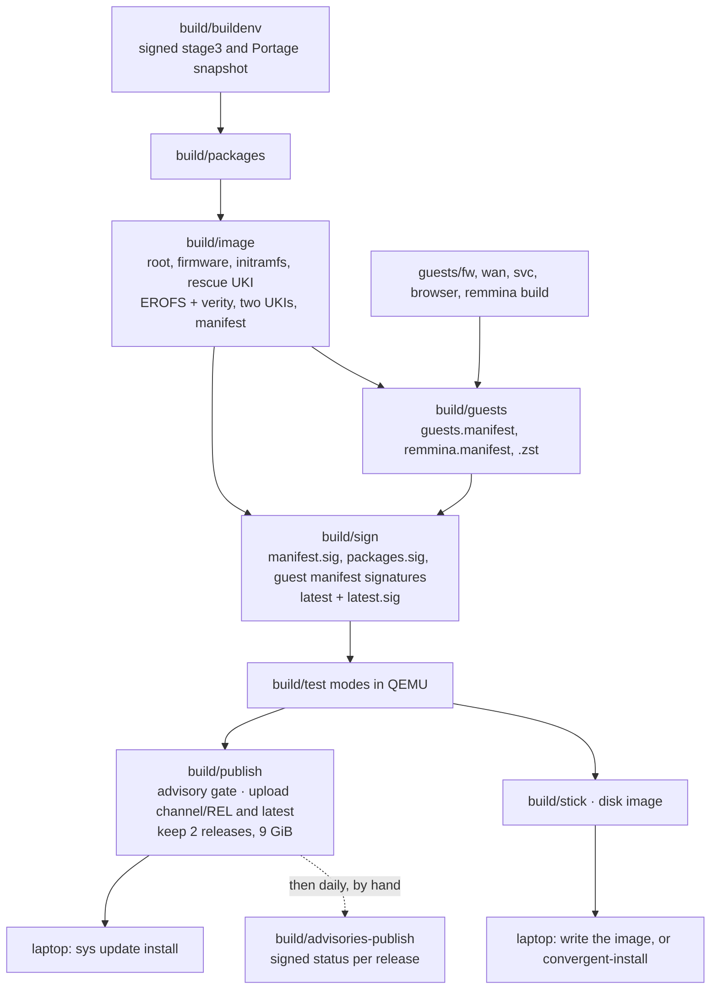

# Building Convergent

Build, test, sign and publish releases. Design: [ARCHITECTURE 6](ARCHITECTURE.md#6-build-and-keys);
installation: [USAGE, Install](USAGE.md#install).

## How it works



*From the pinned builder to the laptop: one release, signed once, delivered online or on USB.*

The builder compiles packages and assembles the host image. Guest images are built separately and
listed in their own signed manifests. A tested release is either published to a channel or written
to a private disk image. `build/stick` checks neither the signature nor a test result.

### Release checklist

1. Bump `VERSION` in `build/build.conf`.
2. Run `build/image` ([Host image](#host-image)).
3. Build the guests and run `build/guests` ([Guest images](#guest-images)).
4. Run `build/sign` when the channel key is offline ([Sign](#sign)).
5. Run the `build/test` modes ([Test in QEMU](#test-in-qemu)).
6. Run `build/publish` ([Publish](#publish)).
7. Run `build/advisories-publish` ([Daily advisory status](#daily-advisory-status)).
8. Tag the commit ([Channels](#channels)).

## Status

| State | Coverage |
|---|---|
| Proven in QEMU | Boot, unlock, bless, fallback, corrupt image refusal, interrupted update |
| Proven in QEMU | Infrastructure setup, guest failover and rollback, disk image boot |
| Proven on laptop | Boot, unlock, autogrow, setup, Sway and bar |
| Proven on laptop | Wi-Fi, online host update, `def`, `int` |
| Laptop testing incomplete | `tmp` and portal, audio, Bluetooth, power, online guests |
| QEMU and laptop tests pending | Standalone Rescue; `build/test --rescue` |
| Not built | Secure Boot signing, including Rescue; leave Secure Boot off |

## Build a release

### Requirements

| Need | Detail |
|---|---|
| Host | Gentoo with KVM, loop devices and network access |
| User | root, from the repository root |
| Gentoo key | `/usr/share/openpgp-keys/gentoo-release.asc` |
| Guest builds | `qemu-system-x86_64`, `qemu-img`, OVMF, `signify`, `python3`, `jq`, `curl` and `zstd` |
| Tests | VM RAM 4 GiB, or 8 GiB in guest modes; a sparse 16, 48 or 64 GiB disk |

No build script checks free disk space. Leave room for the releases, the caches and the test disks.

### Configuration

The build reads `/etc/convergent/config.yaml`, or the file `CONVERGENT_CONFIG` names. Without a
file the built-in defaults apply. `config.example.yaml` lists every key and its default.

- `tools/config-get` validates each key; an unknown, duplicate or invalid key stops the build.
- Image settings are baked into the release.
- Owner, disk, state, swap and image size inputs apply only to an install or a disk image.
- Use the same config for the host, `fw`, `wan` and `svc` builds.

Installer keys and value ranges: [USAGE, Install options](USAGE.md#install-options).

### Host image

```sh
build/buildenv
build/packages
build/image
```

- `build/buildenv` creates the builder chroot from a signed, pinned stage3 and Portage snapshot.
- `build/packages` builds the image packages; `--pretend` previews them. Patched packages never come
  from binary packages; all rebuild when any patch changes.
- `build/image` assembles the release. One UKI per slot carries the main and Recovery profiles.

Bump `VERSION` in `build/build.conf` for each
release: major.minor.patch, optional -rcN. The version appears in `/usr/lib/convergent/version`,
`CONVERGENT_VERSION`, the boot titles, the manifest and the status. The release ID is the UTC
time, `YYYYMMDDHHMM`. It names the artifacts, sets `IMAGE_VERSION` and orders updates and
fallback.

Output: `/var/lib/convergent/builder/releases/<release>`.

### Guest images

Assemble the guests in one directory, here `$g`:

```sh
g=/var/lib/convergent/out/guests
mkdir -p $g/fw $g/wan $g/svc $g/browser/incus $g/remmina
guests/fw/build $g/fw
WAN_COUNTRY=SK guests/wan/build $g/wan
guests/svc/build && cp guests/svc/out/* guests/svc/incus.yaml $g/svc/
guests/browser/build && cp guests/browser/out/* $g/browser/ &&
  cp guests/browser/incus/*.yaml $g/browser/incus/
sh guests/remmina/build && cp guests/remmina/out/* $g/remmina/
build/guests <release-dir> $g
```

`build/guests` writes `guests.manifest` and `remmina.manifest`, compresses the VM disks to `.zst`
and signs when the channel key is present. Keep these images together: `build/networks` renders
the registry, topology hash, profiles, DHCP, DNS and rules, and the `fw` and `wan` checksums bind
that topology.

**fw.** OpenBSD 7.9 plus errata. signify verifies the sets and package checksums. A temporary DHCP
boot runs `syspatch` and `pkg_add -u`; a smoke boot under the QEMU sandbox follows. Per-node
`.syspatch` lists and `openbsd.version` enter the signed payload.

**wan.** `WAN_COUNTRY` sets the regulatory country. Set, even empty, it overrides `wifi_country`;
the build stops unless the result is two capital letters.

**svc.** Built from Alpine 3.24 plus pinned edge builds listed in `guests/svc/packages`, and the
pinned Grafana VictoriaLogs plugin.

**browser.** Takes any Alpine Chromium at or above 156.0.8078.79-r0, since Alpine deletes a build
when it ships the next. `nss-tools` imports the Incus UI session certificates.

**remmina.** Builds as root on native x86_64 Linux. It compiles a patched Remmina 1.4.43 for
Secret Service-only password storage, keeps the Alpine plugins and removes the build
dependencies. Any Alpine rebuild of 1.4.43 supplies the plugins; another upstream version stops
the build. The inventory, executable hash and patch ship in the image, and `remmina.manifest`
binds its delivery.

The host installs pinned Zabbly Incus UI assets at `/usr/share/incus-ui`, without Debian scripts
or a Node build.

### USB disk image

```sh
build/stick <release> $g <out.img> [size]
zstd -T0 <out.img>
```

`build/stick` runs the real installer onto a loop device, then prints the image's SHA-256 and the
`dd` command to write it.

- **Passwords.** It asks for the owner password, then the LUKS passphrase: 12–256 bytes each, and
  twice each at a terminal. Entries that differ are refused. The
  LUKS passphrase must use printable ASCII (space through `~`). Piped input supplies one line each.
- **Owner.** `CONVERGENT_INSTALL_OWNER`, then `owner_login` in the config file, then a prompt.
- **Size.** `[size]` defaults to `image_size` (30G); bytes or a K, M, G or T suffix. State is
  always `auto` and grows on first boot. The image holds the ESP, both slots, 12 GiB of state and
  any state swap from `install.swap`: even 1 GiB of state swap exceeds the default size.

> [!CAUTION]
> A disk image contains the owner's account. Never publish it.

### Builder caches

The builder keeps verified copies of files upstream later prunes; they survive a builder rebuild.

| Cache | Path | Check on use |
|---|---|---|
| Stage3 pair | `/var/cache/convergent/stage3` | signature and `STAGE3_SHA256`; a failing pair is removed |
| Distfiles, Portage snapshot | `/var/cache/convergent/distfiles` | Portage Manifest; snapshot digest and signature |
| Alpine downloads | `/var/cache/convergent/alpine` | pin; a mismatch is removed and fetched again |

The distfiles cache is the builder's `DISTDIR`. The Alpine cache (`CACHE_DIR`) holds the
minirootfs, the Remmina source and Alpine's dsofix patch, the Grafana VictoriaLogs plugin and svc's
edge apks.

Keep the Alpine cache: edge serves only its newest build. Downloads get a 30 s connect timeout,
an hour per try and two retries. `apk` network failures get three tries; a signature or integrity
error stops at once.

## Sign and publish

### Channels

| Channel | Published | Carries |
|---|---|---|
| dev | no | unpublished work |
| beta | yes | built, tested releases; candidates tagged such as v0.1.0-rc1 |
| stable | yes | the final release, such as v0.1.0, rebuilt from its candidate tag |

Releases move dev → beta → stable ([Promote to stable](#promote-to-stable)). `CHANNEL` in
`build/build.conf` defaults to `beta`; set it in the environment to override. `latest` is the
signed pointer a laptop reads. The embedded URL and key prevent cross-channel re-signing.

### Keys

Each published channel has an Ed25519 pair. `/etc/convergent/keys` holds each `<channel>.pub` and
`beta.key`; `stable.key` stays offline.

`build/image` embeds `<channel>.pub` and the update URL from `R2_PUBLIC_URL` in
`/etc/convergent/r2-<channel>.env` ([Publish](#publish)). Create that file first: without it the
release cannot be signed or published. Without the `.pub` the release accepts only unsigned writes.

1. Create the key directory:

   ```sh
   install -d -m 700 /etc/convergent/keys
   cd /etc/convergent/keys
   ```

2. Create the beta pair:

   ```sh
   openssl genpkey -algorithm ed25519 -out beta.key
   openssl pkey -in beta.key -pubout -out beta.pub
   ```

3. Create the stable pair with the plaintext only in tmpfs. The `pkcs8` command asks for a
   passphrase:

   ```sh
   t=$(mktemp -d /dev/shm/stable.XXXXXX)
   openssl genpkey -algorithm ed25519 -out "$t/stable.key"
   openssl pkcs8 -topk8 -v2 aes-256-cbc -iter 1000000 -in "$t/stable.key" \
     -out /media/offline/stable.key
   openssl pkey -in "$t/stable.key" -pubout -out stable.pub
   rm -r "$t"
   ```

4. Return to the repository root.

OpenSSL's default for an encrypted key is 2048 PBKDF2 rounds. Rewrap an older stable key with the
same `pkcs8` command and the old file as `-in`; it asks for the old passphrase, then the new one.
Owner trust and unsigned updates: [USAGE, Host updates](USAGE.md#host-updates).

### Sign

`build/image` and `build/guests` sign when `<channel>.key` exists. Sign by hand with an offline
key:

```sh
CHANNEL=stable build/sign <release-dir> /media/offline/stable.key
```

`build/sign` writes `manifest.sig`, `packages.sig`, `guests.manifest.sig` and
`remmina.manifest.sig` when present, `latest` and `latest.sig`. An encrypted key asks for its
passphrase once per signed file, up to five times.

Signing and publication require the release's provenance to match the channel and key, except
for the [bleeding-edge bridge](#the-bleeding-edge-bridge). The build-host-only `provenance` file
records:

- `release-key`: the SHA-256 of the canonical public PEM with a final newline, or `none`;
- `update-channel`: the channel the embedded URL names, or `none`.

Missing or mismatched provenance, or an inventory that does not match the manifest, needs a
rebuild. Each slot and UKI needs exactly one hash and an accurate size.

### Publish

`build/publish <release-dir>` reads `/etc/convergent/r2-<channel>.env`. Create it mode 600 with:

| Variable | Use |
|---|---|
| `R2_ACCOUNT_ID`, `R2_ACCESS_KEY_ID`, `R2_SECRET_ACCESS_KEY` | credentials; limit the token to the bucket |
| `R2_BUCKET` | the bucket |
| `R2_PUBLIC_URL` | the public URL that `build/image` embeds |
| `R2_ENDPOINT` | optional; set it for an EU bucket |

- **What goes up.** The verified host, guest and Remmina payloads go to `<channel>/<release>/`.
  The signed `<channel>/latest` binds the release and the guest manifest hashes (`none` if
  absent). Download sizes are bounded.
- **Order.** Signatures upload first; rerunning the publisher repairs an interrupted upload.
- **Retention.** At most two releases per channel remain, under a 9 GiB bucket cap.
- **Immutability.** An advertised release is immutable. A retry compares the file set and bytes,
  including `latest` and its signature, and writes nothing if they match. New content or a
  re-signed pointer needs a new release ID.
- **Space.** Retry comparisons download one file at a time; reserve space for the largest payload.
- **Replay.** A replayed signed pointer can withhold releases; the laptop reports its age.

Publishing runs the advisory gate after the local checks and before any bucket access
([Advisories](#advisories)).

#### The bleeding-edge bridge

For laptops still on `bleeding-edge`, `beta.{key,pub}` must match `bleeding-edge.{key,pub}`.
Keep both `r2-beta.env` and `r2-bleeding-edge.env`. Publish the same signed directory twice,
without re-signing:

```sh
build/publish <release-dir>
CHANNEL=bleeding-edge build/publish <release-dir>
```

Laptops switch to the embedded beta URL after they boot the release. Then retire the bridge.

### Promote to stable

1. Check out the candidate tag's exact commit.
2. Rebuild with `CHANNEL=stable`, `stable.pub` in `/etc/convergent/keys` and `r2-stable.env` in
   `/etc/convergent`. Stable omits the debug tool.
3. Sign offline:

   ```sh
   CHANNEL=stable build/sign <release-dir> /media/offline/stable.key
   ```

4. Run the full test suite ([Test in QEMU](#test-in-qemu)).
5. Publish:

   ```sh
   CHANNEL=stable build/publish <release-dir>
   ```

### Rotate a key

Use these steps to rotate a channel key or replace a leaked one. Laptops trust only the key their
release embeds, so they refuse the new signatures until moved over by USB.

1. Create a new pair ([Keys](#keys)).
2. Build, sign and publish a release with it.
3. On each laptop, mount the USB release ([USAGE, USB updates](USAGE.md#usb-updates)).
4. Write it without the signature check:

   ```sh
   sudo env CONVERGENT_UNSIGNED=1 slot write /run/usb/<release>
   ```

5. Reboot, then run `sys update usb` with the same disk to deliver the guests.

Rescue trusts the new key once that release is good.

> [!WARNING]
> Until a laptop is moved over, it accepts whatever a leaked key signs.

## Advisories

### Publish gate

Before any upload or pruning, `build/publish` runs `build/advisories --gate <release-dir>`. It
checks the host and the shipped guests against:

- Gentoo GLSAs;
- the Alpine secdb of each shipped branch;
- OpenBSD errata, including gaps.

Affected packages, missing patches or inventories, and fetch or parse failures block publication.
Every publish rescans. Kernel and pin freshness are left to the [weekly scan](#weekly-scan). Only
the builder fetches feeds; Portage matching runs in its chroot. Signing stays offline-capable.

The gate needs `python3`, `git`, `curl`, Portage and coreutils `timeout`. The GLSA clone gets a
120 s deadline per try, forced termination 10 s later and one retry from an empty tree after 5 s.
Each feed fetch is bounded to 60 s per try, with two retries.

### Inventories

- **What.** Host packages and slots are inventoried before trimming. svc, browser and Remmina
  inventories are in their root file systems. wan's `wan.manifest` and the firewall version and
  patch lists are in the signed guest payloads.
- **Where.** The host inventory is build-host-only, in `packages` and `packages.sig`. It is not
  published or listed in the host manifest.
- **Binding.** `build/image` binds the inventory to the host manifest digest; `build/sign` and the
  scanner enforce the binding.
- **svc imports.** svc records its edge imports in its root file system; missing or malformed
  provenance blocks publication.
- **Missing.** A missing inventory needs a rebuild.

Retained releases through signed version 0.1.4 still get scans and status without bindings or
apk imports, with coverage notes; 0.1.5 and later require both. Accepted imports without advisory
coverage, such as edge VictoriaLogs, are marked `UNKNOWN` per package in reports and signed
status. They do not block publication or skip checks for covered packages.

### Exceptions

`build/advisories.exceptions` holds one line per target and advisory: `target package advisory
reason`.

| Field | Values |
|---|---|
| target | `host`, `wan`, `svc`, `browser`, `remmina`, `fw1`, `fw2` |
| package | Gentoo category/name; Alpine source origin; OpenBSD `base` |
| advisory | `GLSA-YYYYMM-NN`, a secdb ID (usually a CVE), or `OPENBSD-7.9-001_xserver` |
| reason | concrete text, such as absent OpenBSD sets |

No wildcards, and no exceptions for unreadable data.

Add only reviewed, non-applicable advisories. Gate output lists the accepted reasons. Offline
fixtures: `build/test --advisories`.

### Daily advisory status

After publication, and daily, run as root:

```sh
CHANNEL=beta sh build/advisories-publish
```

It needs the channel keys and R2 environment; stable needs the stable key. It signs and uploads
`advisories.json` and its signature for each published release: release ID, generation time,
package versions, every finding including excepted ones, and coverage notes.

- A failed or incomplete scan keeps the previous status and fails the run.
- Scans verify the published manifests, not builder packages. Keep retained release directories,
  signed host inventories and guest payloads until pruning.
- Mutable sidecars are excluded from release identity.
- A Remmina release in the bucket needs its retained manifest and payloads.

Laptop evidence: [USAGE, Release and network evidence](USAGE.md#release-and-network-evidence).

### Weekly scan

Once a week, as root, run:

```sh
build/advisories <release-dir> $g
```

Pass both arguments: the default guest directory is not `$g`. It reads upstream fixes and names
what to rebuild: `host`, `kernel`, `fw1`, `fw2`, `svc`, `browser`, `wan` or `remmina`; `guests`
for an old Alpine pin, `host` for an old Portage snapshot. The kernel version comes from the
release; Gentoo packages from its signed build-host inventory.

| Exit | Meaning |
|---|---|
| 0 | nothing to rebuild; `UNKNOWN` coverage notes may appear |
| 1 | something to rebuild; `UNKNOWN` lines may appear too |
| 2 | nothing to rebuild, but a source, inventory or check failed, or the scan could not start |

Daily and weekly reports also compare the pinned Gentoo `www-apps/incus-ui` (upstream
`incus-ui-canonical`) with Zabbly lts-7.0, verifying `InRelease` with
4EFC590696CB15B87C73A3AD82CC8797C838DCFD. The publish gate skips this freshness check.

### Watch

`build/advisory-watch [release-dir [guests-dir]]` gives early warning between scans. It runs as
root, scans like the [weekly scan](#weekly-scan) and then reads:

- OpenSSH release notes and OpenBSD errata for the shipped release;
- Chrome stable desktop updates and Alpine news;
- this and last month's oss-security subjects that match `build/advisory-watch.keywords`.

It appends each new item to `/var/lib/convergent/builder/advisory-watch/queue` as one TSV line:
time, source, ID, title and URL. A source that fails or yields nothing queues
`feed-failure <source>` once a day. Exit 0 means nothing new, 1 new items and 2 a failed run. On
the first run, `WATCH_BASELINE=1` marks the feeds' existing history as seen instead of queueing it.

To run it every 4 hours, add `/etc/cron.d/advisory-watch`:

```sh
0 */4 * * * root sh <repo>/build/advisory-watch >/dev/null
```

Cron mails only errors. Offline fixtures: `sh build/test-advisory-watch`.

## Diagnostics

Diagnostics are beta-only and run as root on the builder.

1. On the laptop, run `sudo debug key`.
2. Pin its output on the builder as `/etc/convergent/keys/debug-laptop.pub`, over a trusted
   channel.
3. Publish a script for 24 hours:

   ```sh
   build/debug send <script-file> <purpose>
   ```

4. After the owner runs it, fetch the output:

   ```sh
   build/debug fetch [id]
   ```

`fetch` decrypts the output, then verifies the pinned laptop signature and the request ID; it
rejects replaced, corrupt or other-request output. It then deletes the output and, for the last
request sent, the published script.
Owner consent, execution and output limits: [USAGE, Health and alerts](USAGE.md#health-and-alerts).

The maintained field check, `build/diagnostics/field-check`, is builder-only:

```sh
build/debug send build/diagnostics/field-check "<purpose>"
```

It reads the release, time, slot and setup state, services, disk and memory, check status lines
(no diffs), guest, kernel and host logs, Incus, the firewalls, `wan` and USBGuard devices. It
never reads keys, seeds or TLS state. `build/image` fails a non-beta image that carries the debug
tool or a builder diagnostic file.

## Test in QEMU

Every mode below needs root. Each boots a throwaway disk in
`/var/lib/convergent/builder/test/<release>-<mode>` and reports pass or fail. The disk, passphrase
and console logs stay there, even after a failure, until that test reruns. Different tests can run
at the same time. Every mode first runs `build/test-topology`, `build/test-leases`,
`build/test-work-gate`, `build/test-release-compat`, `build/test-slot-backup` and
`build/test-seed`.

| Command | Proves | Needs |
|---|---|---|
| `build/test <release>` | boots and marks itself good | |
| `build/test --recovery <release>` | Recovery profile: unlock, continue and bless | |
| `build/test --rescue <release>` | standalone Rescue UKI with both slots empty | |
| `build/test --corrupt <release>` | one flipped bit: verity refuses it, nothing is marked good | |
| `build/test --desktop <release>` | Sway, bar and `sys`: session programs and config | |
| `build/test --fallback <good> <newer>` | broken newer slot: the good one returns | two releases |
| `build/test --interrupt <good> <newer>` | update cut off half-way: still boots | two releases |
| `build/test --update <good> <newer>` | signed slot write and reboot | two signed releases |
| `build/test --guests <release> $g` | plus guests init: firewalls, `wan`, `svc` | 8 GiB RAM |
| `build/test --guests-maint <release> $g` | plus maintenance, DNS, handoff recovery | 8 GiB RAM |
| `build/test --guests-update <release> $g <broken-dir>` | plus guest updates, a rollback | 8 GiB RAM |
| `build/test --online <release> $g` | its guests from the channel | published release, 8 GiB RAM |

`<broken-dir>` must not exist: the test builds a broken svc image there and verifies the rollback.
`build/test --install-options` needs no root; it is listed under [Checks](#offline-fixtures).

QEMU runs as the unprivileged `convergent-qemu` user, created on first use, with `/dev/kvm`'s group
and `-sandbox on`. A test fails if QEMU keeps root IDs or effective capabilities, or lacks seccomp
filtering.

### What the modes verify

- **`--desktop`.** AppArmor enforce labels, clock queries, the metrics scrape, BlueZ D-Bus and
  browser sockets under headless Sway. Bluetooth pairing and audio devices still need a laptop.
- **`--rescue`.** Unlocks, checks the menu and powers off; UKI names and content stay unchanged and
  nothing is blessed. USB writes, password reset, next-slot selection and log export need separate
  testing.
- **Uplink (every guest mode).** Internet access through `wan`'s second NIC (QEMU user
  networking): `fw1` reaches 9.9.9.9:853 and the host resolves a name. With an update URL
  configured, the signed channel must answer.
- **Browsers (every guest mode).** `def` without Wayland, `tmp` versus portal policies and devices,
  portal expiry and closure.
- **Browser migration (every guest mode).** Legacy web and admin from frozen YAML fixtures, then
  `guests update browser` normally and after a SIGKILL at each step of the rename journal.
- **Selftest (every guest mode).** The booted selftest runs as root; only release, verity, nested
  and audit failures gate the test.
- **PF and Remmina (`--guests`, `--guests-maint`).** PF probes per role (`CV-PF ok` or `FAIL`),
  portal reachability before, during and after portal mode, temporary listeners as positive
  controls, L2 frames on the work networks (`build/test-pf`, `build/fixtures/pf-l2`), and a real
  Remmina session through the production launcher (`build/fixtures/remmina-session`).
- **Shutdown (every guest mode).** The drain (`build/fixtures/shutdown`) stops browsers, Remmina
  and the temporary container first, then svc, `wan` and both firewalls. It keeps autorestart
  overrides and ends in guest poweroff.

## Checks

### Image checks

`build/image` checks AppArmor profile syntax, refuses a release ID later than the builder's UTC
clock, and fails if a USB network driver remains in the image.

`build/test --guests-update` checks every metric panel query against real svc scrapes; only
targets marked optional may be empty. It also runs every LogsQL target and checks that forged
hostnames cannot move log records to another host.

### build/lint

Run `build/lint` before a push; it needs no root. On tracked files it checks:

- shell syntax, and shellcheck when installed;
- leaked private keys, session and scratch paths;
- CRLF line endings;
- dashboard JSON drift;
- `incus query` without `--project`, SSH timeout floors and firewall rc.d interpreters;
- that each simple backticked repository path in README, USAGE, RECOVERY and ARCHITECTURE exists.

### Offline fixtures

`build/lint` also runs these; they need `python3`, `jq` and OpenSSL.

| Command | Coverage |
|---|---|
| `sh build/test --install-options` | Installer config, sizing and disks |
| `sh build/test-vm-runner` | The test boot retry loop |
| `sh build/test-bootstrap` | Bootstrap authentication and caches |
| `sh build/test-boot-privacy` | Boot and privacy |
| `sh build/test-account` | Password durability and the shadow bind |
| `sh build/test --networks` | Work configuration and rendering |
| `sh build/test-topology` | Firewall pair journal replay |
| `sh build/test-leases` | Lease reservations across peers, rebuilds and recovery |
| `sh build/test-firewall-heal` | Firewall self-heal |
| `sh build/test --remmina-unit` | Keyring handling and artifact paths |
| `sh build/test --observability` | Status, capture, parsers, dashboards, wan diagnostics, pflogd |
| `sh build/test-incus-ui --offline` | UI credential and session fixtures |

Run separately, also offline:

| Command | Coverage |
|---|---|
| `sh build/test-debug` | Diagnostic output authentication; then `test-diag` |
| `sh build/test-diag` | The `build/diag/` collector; severity of check, facts, power failures |

The collector keeps system data only: personal log lines, serial numbers, MAC and most IP addresses
are removed.
